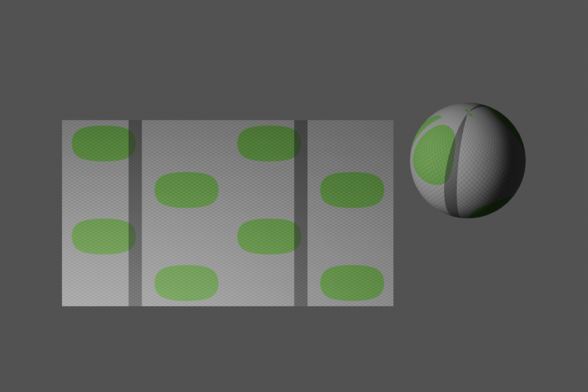
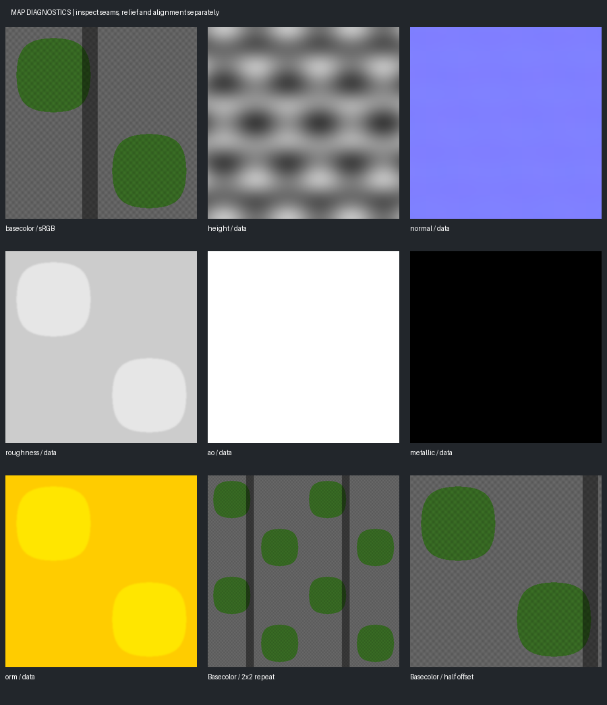

# Reference to PBR Materials

A reusable **Codex / Claude Code skill** for turning surface references into coherent PBR map sets, assembling Blender materials, and preparing game-friendly delivery. Includes Python tools, physical scale metadata, map validation, and actual Blender test renders.

**Based on the reference-to-PBR technique shared by mukade死神 ([@mukadeshinigami](https://x.com/mukadeshinigami)) in “How to make pro-level PBR textures from a single reference (Blender + Claude)”.** Credit for the original technique belongs to him. This project adapts the workflow into a reusable agent skill with additional validation and separate render/game paths. See [CREDITS.md](CREDITS.md).

## Actual test renders



This is an existing **Blender 4.5.3 LTS / Cycles CPU** render from a controlled synthetic test. The deliberate pattern and painted stripe make map alignment and shading behaviour easy to inspect. It demonstrates the working pipeline; it is not a photorealistic material showcase or the original author's artwork.



[View the complete test gallery, moss mask, second lighting direction and evidence](examples/synthetic-stone-moss/README.md).

## What is included

| Component | Purpose |
| --- | --- |
| [SKILL.md](skills/build-reference-pbr/SKILL.md) | Full reference → material workflow, decision rules and completion criteria. |
| [make_maps.py](skills/build-reference-pbr/scripts/make_maps.py) | Registered 16-bit height, OpenGL normals, roughness, AO, metallic and optional ORM maps. |
| [make_masks.py](skills/build-reference-pbr/scripts/make_masks.py) | Separate shading and softened height masks, with a colour overlay. |
| [validate_maps.py](skills/build-reference-pbr/scripts/validate_maps.py) | File and numerical checks, boundary diagnostics and a contact sheet. |
| [build_blender_material.py](skills/build-reference-pbr/scripts/build_blender_material.py) | Blender assembly with game/render modes, real-unit displacement, geometry budgets and optional packed images. |
| [References](skills/build-reference-pbr/references) | Commands, Blender usage, surface decisions, troubleshooting and primary documentation. |
| [Portable tests](tests/test_maps.py) | 26 checks covering map generation, data preservation and invalid inputs. |

## Install on your Mac

Clone or download this repository. Keep the whole `skills/build-reference-pbr` folder together, including `scripts`, `references`, `agents` and `assets`.

```bash
git clone https://github.com/preslife/reference-pbr-skill.git
cd reference-pbr-skill
```

Copy that folder into the appropriate location:

| Agent | Personal installation | Project installation |
| --- | --- | --- |
| Codex | `~/.agents/skills/build-reference-pbr/` | `.agents/skills/build-reference-pbr/` |
| Claude Code | `~/.claude/skills/build-reference-pbr/` | `.claude/skills/build-reference-pbr/` |

For a fresh personal Codex installation:

```bash
mkdir -p "$HOME/.agents/skills"
cp -R skills/build-reference-pbr "$HOME/.agents/skills/"
```

For a fresh personal Claude Code installation:

```bash
mkdir -p "$HOME/.claude/skills"
cp -R skills/build-reference-pbr "$HOME/.claude/skills/"
```

If a folder with that name already exists, back up or deliberately update that installation before copying. These are local installation instructions; downloading the repository does not install anything automatically.

Installation locations follow the [official Codex skill documentation](https://learn.chatgpt.com/docs/build-skills) and [Claude Code skill documentation](https://code.claude.com/docs/en/skills).

### Dependencies

Use **Python 3.10+**, **NumPy** and **Pillow** for the map tools. Use **Blender 4.5+** for material assembly; the actual Blender runtime tested was **4.5.3 LTS**. An image generator is needed only when the task calls for image generation or semantic cleanup. No model provider or paid service is hardcoded.

Create a local Python environment for the examples:

```bash
python3 -m venv .venv
source .venv/bin/activate
python -m pip install -r requirements.txt
```

On macOS, Blender's command-line executable may be at `/Applications/Blender.app/Contents/MacOS/Blender`. Use the actual path for your installed application if `blender` is not on PATH. The builder runs inside Blender; installing `bpy` into your normal Python environment is not required.

## Use the skill

In Codex:

```text
Use $build-reference-pbr on this reference. Create a repeating PBR material
for a Three.js game, with a separate Blender preview. Establish the physical
tile coverage, use authored height where available, inspect maps and seams,
and report which rendering and engine checks were actually performed.
```

In Claude Code, invoke `/build-reference-pbr` with the same task description.

The agent follows the reference preparation, map generation, masking, Blender assembly and verification workflow. The included helpers do not automatically de-light photographs, unwrap meshes, create every preview scene or integrate a game engine. Those task-specific steps are handled by the agent and available tools.

## Run the supplied example

The [synthetic fixture](examples/synthetic-stone-moss/README.md) includes known colour/height inputs, all generated maps, mask previews and reproducible commands. Its dark stripe is pigment, so it should not become a groove in the geometry.

Run the existing map checks from the repository root:

```bash
python3 tests/test_maps.py
```

The 26 checks passed during packaging. Blender material creation was also exercised with game/render switching, scene-unit conversion, geometry-budget rejection, preservation of unrelated scene content, actual Cycles rendering, and saving/reopening packed images. The gallery's two 960×640 renders use the **game normal-map material**, without geometric displacement. No game-engine or physical-device performance claim is made by those renders.

## Design decisions

- Treat colour-derived height as an explicit estimate. Pigment and illumination do not determine geometry.
- Preserve imported height values and genuine 16-bit storage.
- Calculate normals from height using physical tile size and relief amplitude.
- Use periodic processing for repeating textures, then inspect repeat/offset views.
- Keep roughness an authored choice and AO neutral when unknown. Label optional cavity darkening as an approximation.
- Preserve base colour without baked AO. Keep non-colour maps out of display transforms.
- Use explicit geometry budgets and real-unit displacement rather than a fixed subdivision count.
- Separate Cycles render materials from standard glTF/game materials. Core glTF does not carry Blender shader displacement.
- Never call unexecuted Blender or engine checks verified.

## Licence and attribution

The implementation and original documentation are released under the [MIT licence](LICENSE). The procedural sample assets are original project test outputs. The source article and its author's images are not relicensed by this repository and are not bundled. See [CREDITS.md](CREDITS.md) for the technique attribution and source-link status.
