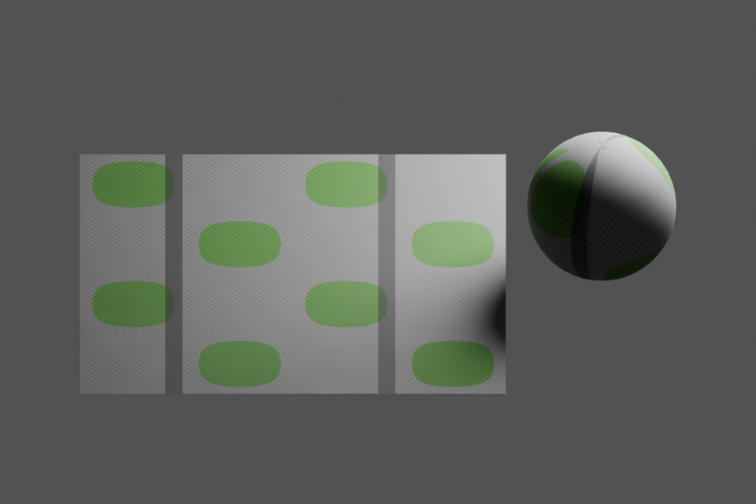
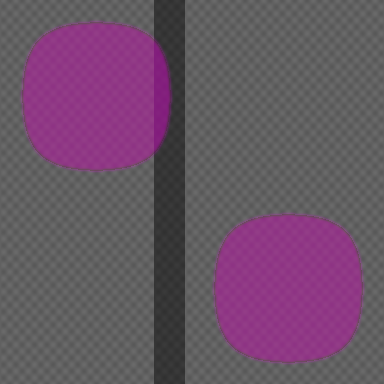

# Synthetic stone / moss test fixture

This controlled procedural sample checks the material pipeline with known colour and height inputs. It demonstrates registration, physical scale, mask handling, and actual Blender execution. It is not a photorealistic material showcase or a reproduction of the tutorial author's artwork.

## Existing test renders

Both images were rendered in **Blender 4.5.3 LTS**, using **Cycles CPU**, **32 samples**, **960 × 640 px**, and **AgX**. They show the game material with tangent-space normal mapping; no subdivision or geometric displacement is used in these two renders.




The plane measures 4 × 4 m and carries 2 × 2 texture tiles. The UV sphere exposes curved-surface behaviour, including pole distortion and a longitude seam from noninteger physical repeats. Use the calibrated plane to assess texture boundaries. The regular synthetic motif remains visibly repeated.

## Map and mask previews




Additional views: [2 × 2 base colour](previews/basecolor_2x2.png), [half-offset base colour](previews/basecolor_offset.png), and [repeated mask overlay](previews/moss_selection_2x2.png).

## Parameters and evidence

| Item | Recorded result |
| --- | --- |
| Source and map dimensions | 384 × 384 px |
| Physical coverage of one tile | 2 × 2 m |
| Height encoding | Genuine 16-bit grayscale PNG; full 0–1 range represents 6 mm |
| Height samples present | 0.239993896–0.760006104 |
| Actual sampled peak-to-peak relief | 3.120073 mm; approximately ±1.560037 mm around midlevel 0.5 |
| Normal convention | Tangent-space OpenGL / +Y |
| Moss selection | HSV hue 70–140°, saturation 0.25–1, value 0–0.8; 25.5059% coverage |
| Roughness | Artist-selected 0.8 for stone/paint, 0.9 for selected moss; smoothly blended |
| AO / metallic | White AO, zero metallic |
| ORM | R = AO, G = roughness, B = metallic |
| Numerical validation | Passed with no errors |
| Height/normal discrepancy | 0.2994° at the 99th percentile after RGB8 quantization |

The dark painted stripe is a colour change. The authored height remains smooth through its boundaries, so preserving that height avoids turning the stripe into a trench. Base-colour pixels and 16-bit height samples were preserved exactly. The soft moss height mask is supplied but was not applied; no additional moss volume was invented.

The preview scene was also saved and reopened successfully during the original test, with all four managed shader images still embedded. The `.blend` file is omitted from this public example; its rendering script is supplied instead. Evidence appears in [source_checks.json](source_checks.json), [blender_checks.json](blender_checks.json), [environment.json](environment.json), and [maps/validation.json](maps/validation.json).

These checks establish the recorded file and Blender behaviour. No game-engine import, compression, mipmapping, GPU-memory, frame-time, or physical-device test was performed for this fixture. Seam statistics cannot establish invisible repetition or photographic fidelity.

## Reproduce the maps

Run from the repository root with NumPy and Pillow installed:

```bash
python3 skills/build-reference-pbr/scripts/make_maps.py \
  examples/synthetic-stone-moss/sources/surface.png \
  --out output/synthetic-stone-moss \
  --name "Procedural stone with moss and painted stripe" \
  --tile-size-m 2 2 \
  --height-range-m 0.006 \
  --height-input examples/synthetic-stone-moss/sources/authored-height.png \
  --roughness-input examples/synthetic-stone-moss/sources/authored-roughness.png \
  --tileable --pack-orm

python3 skills/build-reference-pbr/scripts/validate_maps.py \
  output/synthetic-stone-moss
```

The original roughness source is included. It was calculated as `0.8 + 0.1 × mask_shade`, then rounded to 8-bit grayscale precision. The masks and their exact parameters are in `masks/`.

## Reproduce the Blender previews

Launch a **fresh background Blender process** from the repository root:

```bash
blender --background --python examples/synthetic-stone-moss/create_preview.py
```

On macOS, use the executable inside the installed Blender application if `blender` is not on PATH. The script resets its Blender process to an empty scene. It overwrites the generated example previews and check report, then creates `material_preview.blend` alongside this file. Keep a separate working copy if preserving the published reference images matters.

The public script changes only path resolution from the previously executed preview script so it can find the shared skill in this repository. That packaging adjustment was syntax-checked; the included images and evidence are the existing original test outputs, not a newly claimed render run.

## Provenance

The procedural sources, derived maps, masks, and renders in this folder were created during development of this skill. No original-author photographs, social-media screenshots, private project assets, or test-machine paths are included. Technique attribution is recorded in the repository's [CREDITS.md](../../CREDITS.md).
